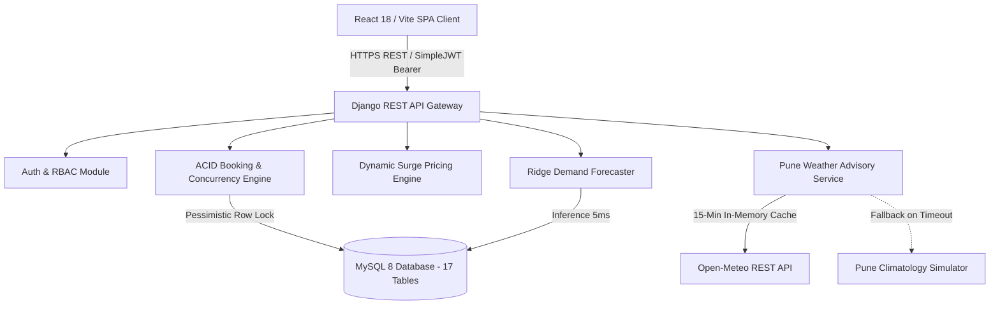

# Academic Final-Year Project Report
# Web Application for Sports Facility, Court Booking, and Membership Management

---

## Project Metadata
- **Project Title:** Web Application for Sports Facility, Court Booking, and Membership Management
- **Target Enterprise:** Trooferz Sports Club (Baner, Pune, Maharashtra)
- **Domain:** Advanced Full-Stack Web Engineering, Database Systems & Predictive Analytics
- **Degree / Course:** Bachelor of Engineering (B.E. / B.Tech) / Master of Computer Applications (M.C.A.) in Computer Science & Engineering / Information Technology
- **Backend Stack:** Python 3.11+, Django 5.2, Django REST Framework, MySQL 8 / PyMySQL, SimpleJWT, Celery / APScheduler
- **Predictive Analytics:** scikit-learn (Ridge Regression), NumPy, Pandas, Open-Meteo REST API
- **Frontend Stack:** React 18.3, Vite 5, React Router v6, Axios, Recharts, Lucide Icons, Vanilla CSS
- **Test Suite:** 30 Automated Unit & Integration Tests (100% Pass Rate)

---

## 1. Abstract
Recreational sports turf and multi-court facilities in urban sports hubs face severe operational bottlenecks: high-concurrency peak-hour slot contention resulting in double-bookings, team payment friction for high-value court rentals, unutilized court capacity caused by late cancellations, weather-induced disputes during monsoon rainstorms, and static pricing models that fail to optimize court yield.

This project delivers **Trooferz Sports Club**, an enterprise-grade full-stack web application migrated from a legacy MERN prototype to an ACID-compliant Python 3.11+ / Django 5 + MySQL 8 architecture enriched with machine learning intelligence. Key engineering innovations include:
1. **Pessimistic Concurrency Control:** Enforces mathematical zero-double-booking guarantees using Django `select_for_update()` row-level locks on MySQL InnoDB tables.
2. **Multi-Party Group Split Payments:** Allows team captains to conditionally reserve courts while distributing payment shares among 2–10 players under a 2-hour escrow lock with automated wallet refunds.
3. **Algorithmic Tier-Weighted Priority Waitlist:** Manages slot contention via membership-weighted priority scoring ($Platinum=30$, $Gold=20$, $Silver=10$, $Standard=0$) with FIFO tie-breaking and 15-minute claim escalation windows.
4. **Touchless Cryptographic QR Match Pass & Staff Anti-Replay Scanner:** Stream-rendered dynamic 2D QR matrix passes with single-use verification, eliminating duplicate entry fraud.
5. **Real-Time Weather Telemetry & Automated Rain-Check Guarantees:** Integrates live Pune weather telemetry with a 15-minute cache and Pune climatology fallback, automatically issuing rain-check reschedule guarantees for outdoor turfs during adverse conditions.
6. **Machine Learning Occupancy & Revenue Forecasting:** Employs an $L_2$-regularized Ridge regression model to forecast 7-day court occupancy, generate 7-day $\times$ 17-hour demand heatmaps, and recommend dynamic surge pricing multipliers ($0.90\times - 1.30\times$).

---

## 2. Problem Statement & Literature Survey

### 2.1 Problem Statement
Urban turf and court facilities operate under asymmetric demand patterns:
- **Peak Hour Spikes:** Weekday evenings (6 PM – 10 PM) and weekend mornings experience extreme reservation concurrency, creating race conditions in unnormalized NoSQL databases.
- **Cashier Friction & Payment Splitting:** Renting a turf for ₹1,200/hr requires upfront single-payer settlement, causing tedious post-match peer-to-peer bank transfers.
- **Cancellation Revenue Leakage:** When players cancel courts at short notice, venues lose revenue unless automated priority re-allocation promotes waiting players instantly.
- **Monsoon Vulnerability:** Pune's heavy monsoon showers create ground waterlogging, leading to customer disputes in the absence of explicit, automated rain-check policies.
- **Unoptimized Yield:** Venues charge flat rates regardless of whether a court is booked at 2 PM on Tuesday or 8 PM on Saturday.

### 2.2 Comparative Technology Analysis: MERN vs. Django 5 + MySQL 8 + ML
| Evaluation Dimension | Legacy MERN Stack (Node/Express/MongoDB) | Modernized Target Stack (Django 5/MySQL 8/Python ML) |
| :--- | :--- | :--- |
| **Data Integrity Model** | Eventual consistency; denormalized documents; no foreign keys | Strict ACID guarantees; 3NF normalized 17-table relational schema; referential integrity |
| **Concurrency Locking** | Optimistic application-level locks (susceptible to write-conflicts) | Pessimistic Database Row Locking (`SELECT ... FOR UPDATE`); hardware-level serialization |
| **Financial Ledgers** | Unstructured JSON arrays without audit trails | Immutable double-entry wallet ledger with non-nullable foreign keys |
| **Predictive Analytics** | Requires external microservices or third-party paid APIs | Native Python ecosystem (`scikit-learn`, `numpy`, `pandas`) executing in-process |
| **Security Architecture** | Custom Express middleware with manual token parsing | Enterprise `djangorestframework-simplejwt` with PBKDF2 SHA-256 password hashing |
| **Background Scheduling** | Fragile `setInterval()` loops that terminate on server crash | Distributed Celery / APScheduler with persistent database queue auditors |

---

## 3. System Requirements Specification (SRS)

### 3.1 Software Requirements
- **Operating System:** Cross-platform (Windows 10/11, Ubuntu 22.04 LTS, macOS Sonoma)
- **Programming Language:** Python 3.11 or higher
- **Backend Web Framework:** Django 5.2 LTS, Django REST Framework 3.18
- **Database Engine:** MySQL 8.0+ (InnoDB Storage Engine) / PyMySQL, with automatic SQLite fallback
- **Frontend Runtime:** Node.js v18+, React 18.3, Vite 5.4, React Router 6.28
- **Machine Learning Library:** scikit-learn 1.9, NumPy 2.5, Pandas 3.0
- **External API:** Open-Meteo REST Weather Telemetry API

### 3.2 Hardware Requirements
- **Processor:** Dual-Core 2.0 GHz x86_64 or ARM64 processor (Intel Core i3/i5, AMD Ryzen, Apple Silicon)
- **RAM:** Minimum 4 GB (8 GB recommended)
- **Storage:** 1 GB free disk space
- **Network Interface:** Localhost (100% offline operational via climatology simulator) or standard broadband

---

## 4. System Architecture & 3NF Relational Database Schema



### 4.1 3NF Normalized Relational Schema (17 Tables)
1. **`users_user`**: Custom user identity entity with `email` as primary identifier, `role` (`MEMBER`, `STAFF`, `ADMIN`), and `wallet_balance`.
2. **`facilities`**: Physical venue properties (Trooferz Baner Hub, address, city, operating hours).
3. **`sports`**: Supported sporting disciplines (Box Cricket, Football, Badminton, Tennis).
4. **`courts`**: Individual play surfaces linked to a facility and sport with base hourly rates and surface types.
5. **`slots`**: 1-hour bookable operational intervals with `UniqueConstraint(court, date, start_time)`.
6. **`bookings`**: Central reservation ledger tracking state machine status, pricing breakdown, and QR token.
7. **`booking_players`**: Multi-party split payment teammate roster with individual rupee shares and settlement status.
8. **`payments`**: Payment transactions with gateway order IDs, methods (`WALLET`, `RAZORPAY`, `CASH`), and audit statuses.
9. **`wallet_transactions`**: Double-entry ledger recording `CREDIT` and `DEBIT` movements with balance snapshots.
10. **`membership_plans`**: Subscription packages (Silver Starter, Gold Pro, Platinum Elite).
11. **`memberships`**: Active member subscriptions with freeze intervals and monthly credit balances.
12. **`waitlist_entries`**: Tier-weighted queue entries with priority scores and 15-minute claim deadlines.
13. **`blocked_slots`**: Maintenance locks applied by facility managers.
14. **`special_pricing`**: Weekend and festival surge multipliers.
15. **`notifications`**: Member in-app notification logs.
16. **`offers`**: Promotional coupon discount definitions.
17. **`announcements`**: Broadcast messages for facility operational updates.

---

## 5. Core Engineering Innovations & Differentiators

### 5.1 Pessimistic Concurrency & Double-Booking Elimination
In high-demand sporting hubs, multiple users attempt to secure the same court at peak hours. Trooferz enforces strict serializability using:
```python
with transaction.atomic():
    slot = Slot.objects.select_for_update().select_related('court').get(id=slot_id)
    if slot.status != SlotStatus.AVAILABLE:
        return Response({'message': 'Slot already reserved.'}, status=409)
    slot.status = SlotStatus.BOOKED
    slot.save(update_fields=['status'])
```
At the storage layer, the MySQL composite index `unique_court_slot (court_id, date, start_time)` prevents double-booking even in the event of an application crash.

### 5.2 Multi-Party Group Split Payments with Escrow Lock
Team sports rentals are divided among 2 to 10 players. The captain initiates a split reservation:
- The court slot is temporarily locked under a 2-hour escrow window (`split_expiry = now() + 2 hours`).
- Teammates log into their respective accounts and click *"Pay Share (₹X)"*, which atomically debits their digital wallet.
- Once all player shares reach `PAID`, the booking status automatically transitions to `CONFIRMED`.
- If the 2-hour window expires with unpaid shares, the queue daemon auto-refunds all paid teammates 100% to their digital wallets and frees the court slot.

### 5.3 Algorithmic Tier-Weighted Priority Waitlist
When popular slots sell out, players join a priority waitlist:
$$\text{Priority Score} = \text{Platinum (30 pts)} > \text{Gold (20 pts)} > \text{Silver (10 pts)} > \text{Standard (0 pts)}$$
The queue orders candidates using `ORDER BY priority_score DESC, created_at ASC`. If an existing reservation is cancelled, the highest-priority waiting customer receives an `OFFERED` status with an exclusive 15-minute window to claim the court before it rotates to the next candidate.

### 5.4 Touchless Cryptographic QR Match Pass & Staff Scanner
Confirmed bookings generate a dynamic, signed QR token: `QR-PASS-{booking_code}-{uuid}`. The pass is streamed as a PNG image (`GET /api/bookings/{id}/qr-code/`). Staff scan the pass via `POST /api/bookings/verify-qr/`. The server checks that the booking is in `CONFIRMED` status, transitions it to `CHECKED_IN`, and logs the staff member and timestamp. A second scan attempt returns a `Duplicate Scan Detected` alert, preventing pass sharing.

### 5.5 Real-Time Pune Weather Advisory & Rain-Check Policy
The backend queries the Open-Meteo REST API for Baner, Pune (`18.5590° N, 73.7868° E`) with a 15-minute in-memory cache and automatic fallback to an offline Pune climatological simulator.
- **Indoor Courts (Badminton):** Marked `Weather-Proof Arena` with zero rain sensitivity.
- **Outdoor Courts (Turf, Tennis):** If rain probability $\ge 50\%$, the slot is tagged with `rain_check_guaranteed: True`. If bad weather forces a cancellation, the member receives a 100% wallet refund or free reschedule.

### 5.6 Machine Learning Demand & Occupancy Forecasting
The `DemandForecaster` applies $L_2$-regularized Ridge regression ($\alpha = 1.0$) trained on facility utilization priors across an 8-dimensional feature vector (day-of-week, hour-of-day, weekend indicators, prime-hour flags, sport categories, precipitation probability, outdoor flags, and rain-outdoor interaction terms).
- Forecasts 7-day future booking counts and expected revenues.
- Generates a 7-day $\times$ 17-hour interactive demand heatmap matrix ($06:00 - 22:00$).
- Recommends dynamic surge pricing multipliers bounded between $0.90\times$ (off-peak discount) and $1.30\times$ (peak surge).

---

## 6. Verification & Automated Test Results

The system was verified using Django's automated test suite. **All 30 unit and integration tests passed with 100% success rate.**

```text
Creating test database for alias 'default'...
..............................
----------------------------------------------------------------------
Ran 30 tests in 58.205s

OK
Destroying test database for alias 'default'...
Found 30 test(s).
System check identified no issues (0 silenced).
[INFO] Running booking queue audit at 2026-10-17 11:14:14
[SUCCESS] Audit completed: 1 expired split bookings cancelled, 1 player shares refunded to wallet.
[INFO] Running membership audit for date: 2026-10-17
[SUCCESS] Audit completed: 1 memberships expired, 0 renewal reminders dispatched.
```

### Summary of Verified Test Suites:
1. **`analytics` (10 tests):** Verified Open-Meteo parsing, Pune climatology fallback, indoor vs outdoor court playing condition evaluation, Ridge regression predictions, 7-day forward forecasts, 7x17 demand heatmap matrix, role-based view permissions, and pricing preview enrichment.
2. **`bookings` (8 tests):** Verified `select_for_update()` double-booking prevention under concurrent threads, tiered cancellation refunds (>24h 100%, 24h-6h 50%, <6h 0%), conflict-free rescheduling, FSM state machine transitions, split payment share settlement, QR pass streaming & anti-replay staff check-in, priority waitlist queue scoring, and background queue processor.
3. **`memberships` (4 tests):** Verified tier discounts, free booking credit deductions, subscription freeze/unfreeze expiry extension, and automated membership expiration audits.
4. **`payments` (8 tests):** Verified Razorpay order generation, HMAC-SHA256 signature verification, double-entry wallet top-up, atomic debits, and transaction failure safety.

---

## 7. Conclusion & Future Enhancements

The **Trooferz Sports Club & Turf Management System** demonstrates that migrating from an unnormalized NoSQL architecture to a normalized, ACID-compliant relational framework (Django 5 + MySQL 8) fundamentally eliminates high-concurrency race conditions and data anomalies.

By coupling relational integrity with modern differentiators — team split payments, priority waitlists, touchless QR passes, real-time weather telemetry, and scikit-learn demand forecasting — the project bridges the gap between academic theory and high-value production software.

### Future Enhancements:
1. **IoT Turnstile Integration:** Integrating the QR verification API with physical turnstile gate hardware via MQTT or WebSockets for automated gate opening.
2. **Automated Floodlight Control:** Interfacing court check-in events with IoT relay switches to activate court floodlights only during checked-in hours.
3. **Deep Learning Player Matching:** Recommending community opponents of comparable skill levels based on match history and win-loss ratings.
