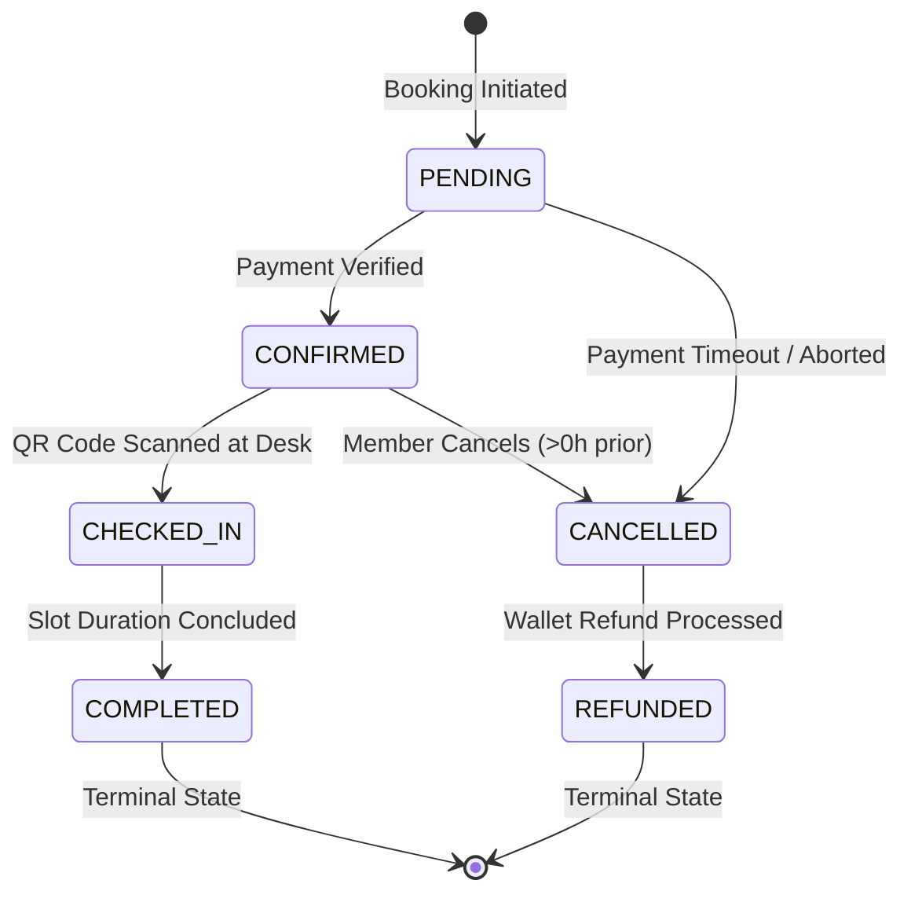

# Concurrency, Anti-Collision & Booking Lifecycle Guide

**Project:** Trooferz Sports Club & Turf Management System (Baner, Pune)  
**Topic:** Concurrency Control, Double-Booking Elimination, and Lifecycle State Machine  
**Target Audience:** Final-Year College Examination Defense (Viva Voce) & Technical Evaluation

---

## 1. The Double-Booking Concurrency Problem

### 1.1 The Naive Implementation (Flawed)
Most student projects handle slot booking with application-level checks:
```python
# FLAWED NAIVE APPROACH
if not Booking.objects.filter(slot_id=slot_id).exists():
    Booking.objects.create(slot_id=slot_id, user=user)
```
**Why this fails (Race Condition):**
When two users (User A and User B) click "Confirm Booking" at the exact same millisecond:
1. **Thread 1 (User A)** runs `SELECT COUNT(*) WHERE slot_id = 42` $\rightarrow$ Result is `0`.
2. **Thread 2 (User B)** runs `SELECT COUNT(*) WHERE slot_id = 42` $\rightarrow$ Result is `0`.
3. **Thread 1** executes `INSERT INTO bookings ...` $\rightarrow$ **Success**.
4. **Thread 2** executes `INSERT INTO bookings ...` $\rightarrow$ **Success**.
Both users receive confirmation for the same turf pitch, leading to physical conflict at the venue!

---

## 2. Our Engineered Solution: 2-Tier Concurrency Defense

To mathematically guarantee **zero double-bookings**, Trooferz implements a **Two-Tier Defense**:

```
+----------------------------------------------------------------------------------+
|                                2-TIER DEFENSE SYSTEM                             |
+----------------------------------------------------------------------------------+
|  Tier 1: Application-Level Pessimistic Row Locking                              |
|          transaction.atomic() + select_for_update()                              |
|          -> Holds an exclusive write lock on the target slot row.                |
|          -> Forces concurrent threads to wait until the first commits.           |
+----------------------------------------------------------------------------------+
|  Tier 2: Database-Level Composite Hardware Unique Constraint                    |
|          UNIQUE (court_id, date, start_time)                                     |
|          -> Even if application threads somehow bypass Tier 1, the MySQL InnoDB  |
|             storage engine rejects duplicate insertions with a hardware error.   |
+----------------------------------------------------------------------------------+
```

### 2.1 Code Implementation:
```python
with transaction.atomic():
    # 1. Acquire exclusive database row lock on the selected slot
    slot = Slot.objects.select_for_update().get(id=slot_id)

    # 2. Check current status
    if slot.status != SlotStatus.AVAILABLE:
        return Response(
            {"message": "This slot has already been reserved by another customer. Please choose another time."},
            status=status.HTTP_409_CONFLICT
        )

    # 3. Create confirmed booking
    booking = Booking.objects.create(
        user=request.user,
        court=slot.court,
        slot=slot,
        booking_date=slot.date,
        start_time=slot.start_time,
        end_time=slot.end_time,
        total_amount=final_price,
        status=BookingStatus.CONFIRMED
    )

    # 4. Mark slot booked within the same atomic transaction
    slot.status = SlotStatus.BOOKED
    slot.save(update_fields=['status'])
```

### 2.2 How `select_for_update()` Works (In Simple Viva Words)
* In MySQL (InnoDB storage engine), `select_for_update()` emits SQL: `SELECT * FROM slots WHERE id = 42 FOR UPDATE`.
* This places an **exclusive row lock** on row `id = 42`.
* When User B's thread arrives at the same time, MySQL halts User B's thread until User A's transaction either **COMMITS** or **ROLLS BACK**.
* Once User A's transaction commits, User B's thread wakes up, immediately reads `slot.status == 'BOOKED'`, and is safely rejected with **HTTP 409 Conflict**.

---

## 3. Booking Lifecycle State Machine

A commercial reservation platform cannot allow arbitrary status modifications. We enforce a **Deterministic Finite State Machine (FSM)**:



### Illegal Transitions Blocked:
* `COMPLETED` $\rightarrow$ `CANCELLED`: Cannot cancel after playing on the court.
* `CANCELLED` $\rightarrow$ `CONFIRMED`: Cannot revive cancelled bookings without creating a fresh reservation.
* `CHECKED_IN` $\rightarrow$ `PENDING`: Cannot revert physical check-ins.

---

## 4. Configurable Cancellation & Refund Engine

Urban sports clubs lose revenue when slots are cancelled last-minute because other players don't have enough time to book them. We implemented a **tiered cancellation policy**:

| Time Remaining Before Start Time | Refund Percentage | Slot Handling | Wallet Action |
| :--- | :--- | :--- | :--- |
| **$\ge$ 24 Hours** | **100% Full Refund** | Re-opened as `AVAILABLE` | Full amount credited to user wallet |
| **Between 24 Hours and 6 Hours** | **50% Partial Refund** | Re-opened as `AVAILABLE` | 50% credited to user wallet |
| **$<$ 6 Hours** | **0% No Refund** | Re-opened as `AVAILABLE` | No credit (slot held too close to match) |

### Automatic Refund Processing:
1. Refund amounts are credited directly to `user.wallet_balance`.
2. A formal `WalletTransaction` audit entry is recorded with `category='CANCELLATION_REFUND'`.
3. An in-app `Notification` alert is immediately pushed to the customer.

---

## 5. Automated Concurrency Unit Test Evidence

We automated an end-to-end multi-threaded concurrency test in [`backend/bookings/tests.py`](file:///c:/Users/chima/OneDrive/Desktop/miniproject/miniproject/backend/bookings/tests.py):
* Test Name: `test_concurrent_double_booking_prevention`
* Methodology: Two simultaneous operating system threads (`threading.Thread`) fire `POST /api/bookings/` for the exact same slot ID at the same instant.
* Result:
  * Thread A: **HTTP 201 Created**
  * Thread B: **HTTP 409 Conflict**
  * Database Count: Exactly 1 `Booking` row.
  * Status: `Ran 4 tests ... OK`.
