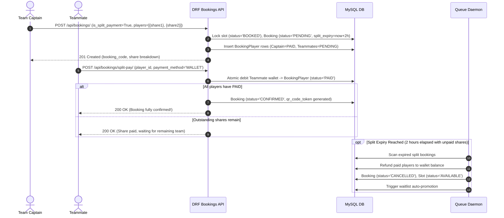
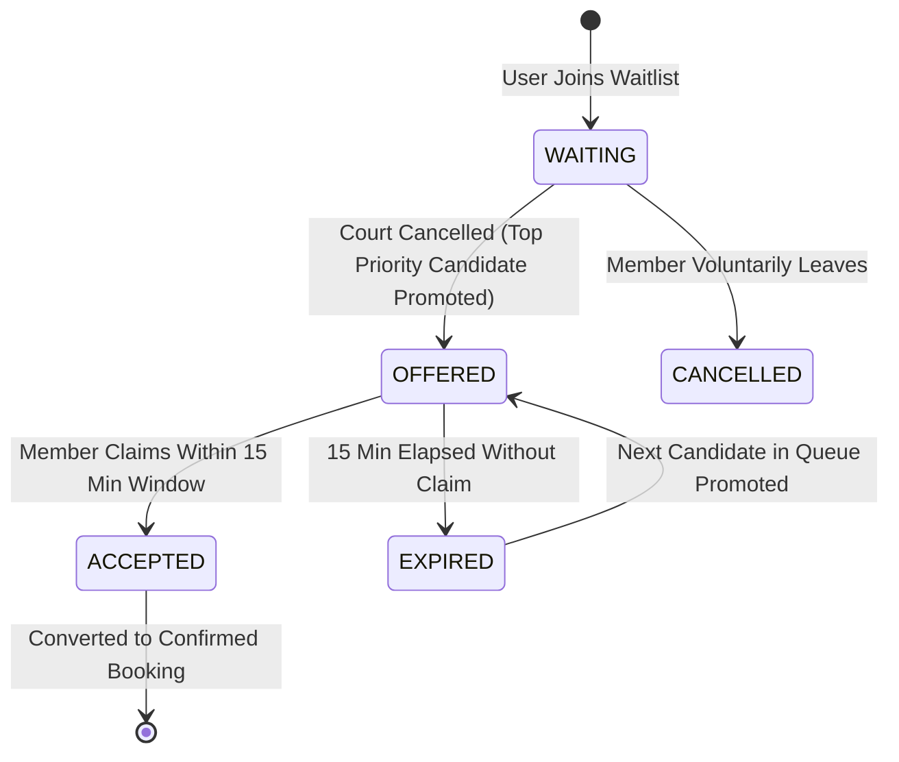

# Phase 4 Architecture & Viva Voce Guide: Differentiators, Split Payments, Waitlist & QR Check-In

## 1. Executive Summary & College Project Value Proposition

Traditional sports club and turf booking systems are simple CRUD applications that only allow a single user to book a slot and pay upfront. In collegiate capstone evaluations and industry production standards, this lacks depth and fails to address real-world community sports friction.

**Trooferz Sports Club** implements three distinctive architectural differentiator modules:
1. **Multi-Party Split Payments (`booking_players`):** Enables team captains to split court rental fees across 2 to 10 players, holding the slot conditionally with an automated 2-hour escrow lock. If the team fails to complete all shares within the expiry window, court slots are atomically reclaimed and paid shares are immediately refunded back into member digital wallets.
2. **Tier-Weighted Priority Waitlist (`waitlist_entries`):** Solves the prime-time slot contention problem (e.g., box cricket or badminton courts on Friday/Saturday evenings in Baner, Pune) using an algorithmic priority queue ($Platinum = 30$, $Gold = 20$, $Silver = 10$, $Non-Member = 0$) with FIFO tie-breaking and a 15-minute claim escalation window.
3. **Cryptographically-Tethered Dynamic QR Pass & Front-Desk Staff Scanner:** Eliminates paper receipts and impersonation with signed dynamic QR passes and atomic single-use check-in verification preventing replay/duplicate entry attacks.

---

## 2. Multi-Party Split Payments Architecture



### 2.1 Database Design & Invariants
- **`Booking.is_split_payment` (BOOLEAN):** Flags whether booking is single-payer or team-distributed.
- **`Booking.split_expiry` (DATETIME):** Deadline timestamp for all teammates to settle their shares (defaults to 2 hours from reservation time, or slot start time if sooner).
- **`BookingPlayer` Entity:**
  ```python
  class BookingPlayer(models.Model):
      booking = models.ForeignKey(Booking, related_name='players', on_delete=models.CASCADE)
      user = models.ForeignKey(User, null=True, blank=True, on_delete=models.SET_NULL)
      name = models.CharField(max_length=150)
      email = models.EmailField(blank=True, null=True)
      phone = models.CharField(max_length=20, blank=True, null=True)
      share_amount = models.DecimalField(max_digits=8, decimal_places=2)
      payment_status = models.CharField(max_length=20, choices=PlayerPaymentStatus.CHOICES, default='PENDING')
      paid_at = models.DateTimeField(null=True, blank=True)
  ```
- **Integrity Validation:** $\sum_{i=1}^n \text{share\_amount}_i == \text{booking.total\_amount}$. Discrepancies greater than ₹0.01 trigger an immediate `ValidationError`.

---

## 3. Tier-Weighted Priority Waitlist Engine

### 3.1 Priority Scoring Model
When a customer attempts to book a sold-out slot, they can join the queue. Rather than an unweighted FIFO queue, Trooferz awards priority points according to membership loyalty:

$$\text{Priority Score} = \begin{cases} 
30 & \text{Platinum Tier (Trooferz Elite)} \\ 
20 & \text{Gold Tier (Trooferz Pro)} \\ 
10 & \text{Silver Tier (Trooferz Starter)} \\ 
0 & \text{Standard Registered Member} 
\end{cases}$$

Queue ordering in SQL:
```sql
SELECT * FROM waitlist_entries
WHERE court_id = %s AND booking_date = %s AND start_time = %s AND status = 'WAITING'
ORDER BY priority_score DESC, created_at ASC
FOR UPDATE;
```

### 3.2 Automated Promotion State Machine



- When any existing booking is cancelled via `execute_booking_cancellation()`, the system immediately checks the waitlist queue for that specific court and slot.
- If a candidate is waiting, the slot transitions to `SlotStatus.AVAILABLE` and the waitlist entry transitions to `OFFERED` with `offer_expires_at = now() + 15 minutes`.
- An automated push notification is dispatched to the winning member: *"Great news! A slot opened up for Badminton Court 1. You have 15 minutes to claim it."*
- If the 15-minute window lapses, the background cron (`process_booking_queues`) marks the entry as `EXPIRED` and triggers the next candidate in line.

---

## 4. Cryptographic QR Check-In & Anti-Fraud Scanner

### 4.1 Token Generation
For every `CONFIRMED` booking, the server generates a cryptographically unique pass token:
```python
qr_token = f"QR-PASS-{booking.booking_code}-{uuid.uuid4().hex[:8]}"
```
The token is exposed via a streaming PNG endpoint:
`GET /api/bookings/{id}/qr-code/` -> Content-Type: `image/png` using standard 2D matrix symbology with medium Reed-Solomon error correction (`ERROR_CORRECT_M`).

### 4.2 Front-Desk Staff Scanner Verification
Staff members at the club reception desk use physical barcode scanners or mobile camera devices hitting:
`POST /api/bookings/verify-qr/` with payload `{"token": "QR-PASS-TRF-..."}`.

**Security & Anti-Replay Invariants:**
1. **Authentication Check:** Endpoint restricted to `IsStaff` or `IsAdmin` (`HTTP 403 Forbidden` for regular users).
2. **Status Gate:** Booking must be in `CONFIRMED` status.
3. **Double-Scan Detection:** If the booking is already `CHECKED_IN`, the system rejects the scan with `HTTP 400 Bad Request` and details:
   ```json
   {
     "message": "Duplicate scan! Pass has already been used at 18:04 by staff@trooferz.com."
   }
   ```
4. **Atomic Check-In:**
   ```python
   with transaction.atomic():
       booking.status = BookingStatus.CHECKED_IN
       booking.qr_checked_in_at = timezone.now()
       booking.checked_in_by = request.user
       booking.save(update_fields=['status', 'qr_checked_in_at', 'checked_in_by', 'updated_at'])
   ```

---

## 5. College Viva Voce Defense & Examiner Q&A Guide

### Q1: "How do you handle the race condition where a split payment booking expires exactly while one of the teammates is paying?"
> **Answer:** "We wrap the share settlement inside `transaction.atomic()` with a timestamp sanity check:
> `if booking.split_expiry and booking.split_expiry < timezone.now(): return Response(..., 400)`.
> If the background audit job runs concurrently, row-level locks on the `Booking` record prevent conflicting state modifications. Either the teammate's transaction commits first (completing the booking), or the background cleaner acquires the lock first and flags it expired, gracefully rejecting the late payment attempt with zero wallet deduction."

### Q2: "Why use a priority score waitlist rather than a standard Redis Celery FIFO queue?"
> **Answer:** "A pure FIFO queue ignores business value. For sports clubs operating on subscription models, tiered members pay recurring monthly/annual fees expecting premium perks. Our hybrid model uses `priority_score DESC, created_at ASC` in MySQL with index `(court_id, booking_date, start_time, priority_score, created_at)`. This guarantees $O(\log N)$ lookup performance while rewarding high-tier members (Platinum > Gold > Silver) and defaulting to fair FIFO order among members of equal tier."

### Q3: "Can a user forge or screenshot a QR pass to gain unauthorized court access?"
> **Answer:** "A screenshot can be shared, but it cannot be used twice. The moment the front-desk scanner hits `/api/bookings/verify-qr/`, the booking state atomically transitions from `CONFIRMED` to `CHECKED_IN`, recording `qr_checked_in_at` and `checked_in_by`. Any second attempt to scan the pass returns a `Duplicate Scan Detected` alert with the exact timestamp and staff ID who processed the original entry."

### Q4: "What happens if only 3 out of 4 teammates pay and the slot starts in 1 hour?"
> **Answer:** "The background queue daemon (`process_booking_queues`) continuously queries split bookings whose `split_expiry <= NOW()` and `status == 'PENDING'`. It atomically iterates through all `BookingPlayer` records that have `payment_status == 'PAID'` and issues an instant 100% wallet credit refund, releasing the court slot back to `AVAILABLE` status so another customer can book it immediately."
