# Entity-Relationship (ER) Diagram: Trooferz Sports Club & Turf Management System

**Database Engine:** MySQL 8 (InnoDB Engine, utf8mb4)  
**Normal Form:** Third Normal Form (3NF)  
**Date:** October 2026  
**Domain:** Sports Facility, Multi-Court Scheduling & Membership Management (Baner, Pune)

---

## 1. Visual Entity-Relationship Diagram (Mermaid)

```mermaid
erDiagram
    users_user ||--o{ bookings : "places"
    users_user ||--o{ memberships : "subscribes"
    users_user ||--o{ payments : "makes"
    users_user ||--o{ wallet_transactions : "owns"
    users_user ||--o{ waitlist : "joins"
    users_user ||--o{ equipment_rentals : "rents"
    users_user ||--o{ reviews : "writes"
    users_user ||--o{ notifications : "receives"
    users_user ||--o{ booking_players : "participates"

    facilities ||--|{ courts : "contains"
    facilities ||--o{ equipment : "stocks"
    sports ||--|{ courts : "categorizes"
    sports ||--o{ equipment : "classifies"

    courts ||--|{ slots : "schedules"
    courts ||--o{ pricing_rules : "modulates"
    courts ||--o{ bookings : "hosts"
    courts ||--o{ waitlist : "queues"
    courts ||--o{ reviews : "receives"

    slots ||--o| bookings : "reserves"

    bookings ||--o{ booking_players : "splits_with"
    bookings ||--o{ payments : "billed_by"
    bookings ||--o{ equipment_rentals : "includes"
    bookings ||--o| reviews : "verified_for"

    membership_plans ||--o{ memberships : "defines"
    memberships ||--o{ payments : "billed_by"

    users_user {
        bigint id PK
        varchar email UK
        varchar username UK
        varchar full_name
        varchar phone
        varchar role "MEMBER, STAFF, ADMIN"
        decimal wallet_balance
        boolean is_active
        datetime date_joined
    }

    facilities {
        int id PK
        varchar name
        text description
        varchar address
        varchar city
        varchar area
        time opening_time
        time closing_time
        varchar image_url
        boolean is_active
    }

    sports {
        int id PK
        varchar name UK
        varchar slug UK
        text description
        varchar icon
        varchar image_url
        boolean is_active
    }

    courts {
        int id PK
        int facility_id FK
        int sport_id FK
        varchar name
        varchar court_type "INDOOR, OUTDOOR"
        varchar surface_type
        int capacity
        decimal hourly_base_price
        boolean is_active
    }

    slots {
        bigint id PK
        int court_id FK
        date date "Indexed"
        time start_time
        time end_time
        varchar status "AVAILABLE, BOOKED, BLOCKED, MAINTENANCE"
    }

    pricing_rules {
        int id PK
        varchar name
        int court_id FK
        varchar day_type "ALL, WEEKDAY, WEEKEND, HOLIDAY"
        time start_time
        time end_time
        decimal price_multiplier
        int occupancy_threshold_pct
        boolean is_active
    }

    membership_plans {
        int id PK
        varchar tier UK "SILVER, GOLD, PLATINUM"
        varchar name
        decimal price
        int duration_days
        decimal discount_percent
        int free_booking_credits
        int priority_booking_days
        text benefits_summary
        boolean is_active
    }

    memberships {
        bigint id PK
        bigint user_id FK
        int plan_id FK
        date start_date
        date end_date "Indexed"
        int credits_left
        varchar status "ACTIVE, EXPIRED, FROZEN, CANCELLED"
        boolean is_frozen
        datetime frozen_at
    }

    bookings {
        bigint id PK
        varchar booking_code UK
        bigint user_id FK
        int court_id FK
        bigint slot_id FK
        date booking_date "Indexed"
        time start_time
        time end_time
        decimal base_price
        decimal dynamic_multiplier
        decimal discount_amount
        int credits_used
        decimal total_amount
        varchar status "PENDING, CONFIRMED, CHECKED_IN, COMPLETED, CANCELLED, REFUNDED"
        boolean is_split_payment
        datetime split_expiry
        varchar qr_code_token UK
        datetime qr_checked_in_at
        bigint checked_in_by_id FK
        varchar weather_warning
        datetime created_at
    }

    booking_players {
        bigint id PK
        bigint booking_id FK
        bigint user_id FK
        varchar name
        varchar email
        varchar phone
        decimal share_amount
        varchar payment_status "PENDING, PAID, REFUNDED"
        datetime paid_at
    }

    payments {
        bigint id PK
        varchar payment_reference UK
        bigint booking_id FK
        bigint membership_id FK
        bigint user_id FK
        decimal amount
        varchar payment_method "RAZORPAY, WALLET, SPLIT, CASH"
        varchar gateway_order_id
        varchar gateway_payment_id
        varchar gateway_signature
        varchar status "INITIATED, SUCCESS, FAILED, REFUNDED"
        datetime created_at
    }

    wallet_transactions {
        bigint id PK
        bigint user_id FK
        varchar transaction_type "CREDIT, DEBIT"
        varchar category "TOP_UP, BOOKING_PAYMENT, CANCELLATION_REFUND, WEATHER_REFUND, MEMBERSHIP_BONUS"
        decimal amount
        decimal balance_after
        varchar reference_id
        varchar description
        datetime created_at
    }

    waitlist {
        bigint id PK
        bigint user_id FK
        int court_id FK
        date date "Indexed"
        time start_time
        varchar status "WAITING, OFFERED, ACCEPTED, EXPIRED, CANCELLED"
        datetime offered_at
        datetime offer_expires_at
        int priority_score
        datetime created_at
    }

    equipment {
        int id PK
        int facility_id FK
        int sport_id FK
        varchar name
        int total_quantity
        int available_quantity
        decimal rental_price_per_hour
        decimal deposit_amount
        boolean is_active
    }

    equipment_rentals {
        bigint id PK
        bigint booking_id FK
        bigint user_id FK
        int equipment_id FK
        int quantity
        decimal total_fee
        varchar status "RESERVED, ISSUED, RETURNED, LOST"
        datetime issued_at
        datetime returned_at
        bigint issued_by_id FK
    }

    reviews {
        bigint id PK
        bigint user_id FK
        int court_id FK
        bigint booking_id UK
        smallint rating "1 to 5"
        text comment
        boolean is_verified
        datetime created_at
    }

    notifications {
        bigint id PK
        bigint user_id FK
        varchar title
        text message
        varchar notification_type "BOOKING, MEMBERSHIP, WAITLIST, WEATHER, WALLET, SPLIT_PAYMENT, SYSTEM"
        boolean is_read "Indexed"
        datetime created_at
    }
```

---

## 2. Relational Integrity & Integrity Rules

1. **Anti-Collision Constraint:**
   - `slots`: `UNIQUE (court_id, date, start_time)` prevents double-booking a slot at the database engine level.
2. **Review Verification:**
   - `reviews`: `booking_id` has a `UNIQUE` constraint (1:1 with `bookings`), guaranteeing that only confirmed players can write a review and cannot submit multiple reviews for the same session.
3. **Audit Trails & Ledgers:**
   - `wallet_transactions` records the exact `balance_after` following any credit or debit operation, ensuring tamper-evident balances for financial defense.
   - `payments` stores `gateway_order_id`, `gateway_payment_id`, and `gateway_signature` for Razorpay webhook verification and payment audit.
4. **Referential Cascades vs Protection:**
   - `ON DELETE CASCADE` is applied to ephemeral children like `booking_players` when an unconfirmed draft booking is discarded.
   - `ON DELETE PROTECT` is applied to `MembershipPlan` so historical subscription financial records are never broken by plan modifications.
