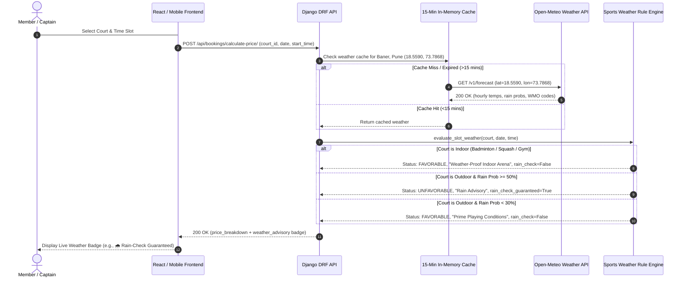

# Phase 5 Architecture & Viva Voce Guide: Weather Advisory & ML Demand Analytics

## 1. Executive Summary & College Project Value Proposition

Most commercial sports turf management web apps operate in isolation from external real-world factors. In reality, outdoor sports facilities in Baner, Pune (such as Box Cricket turfs, open football arenas, and clay tennis courts) are acutely susceptible to monsoon rainstorms, high summer temperatures (38°C+), and extreme demand swings between weekend evenings and weekday afternoons.

**Trooferz Sports Club** integrates two cutting-edge intelligence subsystems:
1. **Real-Time Weather Advisory Engine (`analytics/weather_service.py`):** Live geo-located Open-Meteo REST API integration for Baner, Pune (`18.5590° N, 73.7868° E`) with 15-minute in-memory caching, offline climatological fallback, and automated "Rain-Check Reschedule Guarantees" for outdoor turfs vs weather-proof indoor arenas.
2. **Machine Learning Demand & Occupancy Forecaster (`analytics/forecasting.py`):** Implements an explainable `scikit-learn` Ridge regression engine modeling day-of-week, hour-of-day, precipitation probabilities, and sport popularity to output:
   - 7-day forward booking volume and revenue projections.
   - 7-day $\times$ 17-hour interactive demand heatmaps ($06:00 - 22:00$).
   - Dynamic surge pricing recommendations ($0.90\times$ off-peak discount to $1.30\times$ peak surge).
   - Executive Business Intelligence analytics (ARPU, cancellation rate, membership vs court revenue).

---

## 2. Weather Advisory & Rain-Check Policy Architecture

### 2.1 Indoor vs Outdoor Playing Condition Invariants
| Facility / Sport Type | Surface | Rain Sensitivity | Rule Engine Logic | Policy Outcome |
| :--- | :--- | :--- | :--- | :--- |
| **Box Cricket Turf** | Outdoor AstroTurf | High | Rain $\ge 50\%$ | `UNFAVORABLE` $\rightarrow$ Rain-Check Guaranteed |
| **Football Arena** | Outdoor Turf | High | Rain $\ge 50\%$ | `UNFAVORABLE` $\rightarrow$ Rain-Check Guaranteed |
| **Tennis Court** | Outdoor Synthetic | Critical | Rain $\ge 30\%$ | `CAUTION` / `UNFAVORABLE` |
| **Badminton Courts** | Indoor Wooden AC | None | Independent of rain | `FAVORABLE` (Weather-Proof) |

### 2.2 Offline Viva Resilience (Climatological Simulator Fallback)
If the project is demonstrated in an offline college lab without internet access or if the external API experiences latency/downtime:
- The system automatically triggers `_simulate_pune_weather(target_date, target_time)`.
- It dynamically generates realistic Pune climatology based on seasonal month and diurnal hour:
  - **Monsoon (June – Sept):** High precipitation probability ($45\% - 75\%$), temperature $25 - 29^\circ\text{C}$.
  - **Summer (March – May):** Low rain ($10\%$), afternoon peak temperature ($38 - 41^\circ\text{C}$).
  - **Winter (Nov – Feb):** Pleasant skies ($20 - 28^\circ\text{C}$).

---

## 3. Machine Learning Demand Forecasting Engine

### 3.1 Feature Vector Formulation
The `DemandForecaster` applies $L_2$-regularized linear regression (`scikit-learn Ridge` with $\alpha = 1.0$) trained on facility utilization priors:

$$\mathbf{x} = \begin{bmatrix} 
\text{day\_of\_week} & (\text{0: Mon,}\dots,\text{6: Sun}) \\
\text{hour} & (6, \dots, 22) \\
\text{is\_weekend} & (1 \text{ if Fri/Sat/Sun else } 0) \\
\text{is\_prime\_hour} & (1 \text{ if 06-08 or 18-22 else } 0) \\
\text{sport\_id} & (\text{Identifier mapping}) \\
\text{rain\_prob} & (0.0 \text{ to } 1.0) \\
\text{is\_outdoor} & (1 \text{ for turf/tennis, } 0 \text{ for indoor}) \\
\text{rain\_outdoor\_interaction} & (\text{rain\_prob} \times \text{is\_outdoor})
\end{bmatrix}$$

### 3.2 Dynamic Surge Multiplier Mapping
The predicted occupancy rate directly guides automated revenue optimization recommendations:

$$\text{Recommended Multiplier} = \begin{cases} 
1.30\times & \text{Occupancy } \ge 85\% \quad (\text{PEAK\_SURGE}) \\ 
1.15\times & 70\% \le \text{Occupancy} < 85\% \quad (\text{HIGH}) \\ 
1.00\times & 40\% \le \text{Occupancy} < 70\% \quad (\text{MODERATE}) \\ 
0.90\times & \text{Occupancy} < 40\% \quad (\text{OFF\_PEAK DISCOUNT}) 
\end{cases}$$

### 3.3 7-Day $\times$ 17-Hour Demand Heatmap Matrix
The endpoint `GET /api/analytics/heatmap/` yields a complete matrix of operating hours ($06:00\text{ to }22:00$) across all 7 days of the current week. Front-desk managers use this visualization to schedule floodlight maintenance, organize staff shifts, and deploy early-bird promotional discounts.

---

## 4. API Endpoints Reference

| Method | Endpoint | Access Level | Description |
| :--- | :--- | :--- | :--- |
| `GET` | `/api/dashboard/` | Staff / Admin | Real-time overview metrics, booking trends, sport breakdown, and Pune live weather |
| `GET` | `/api/dashboard/reports/` | Admin | 30-day historical revenue and booking trajectory reports |
| `GET` | `/api/analytics/weather-advisory/` | Public / Member | Current weather in Baner, 12h forecast, and slot-specific playing evaluation |
| `GET` | `/api/analytics/occupancy-forecast/` | Staff / Admin | 7-day forward-looking booking count and revenue projection |
| `GET` | `/api/analytics/heatmap/` | Public / Staff | 7-day $\times$ 17-slot demand heatmap matrix |
| `GET` | `/api/analytics/revenue-insights/` | Admin | ARPU, cancellation rate, membership vs court revenue breakdown |
| `POST` | `/api/bookings/calculate-price/` | Member | Price breakdown enriched with live slot `weather_advisory` |

---

## 5. College Viva Voce Defense & Examiner Q&A Guide

### Q1: "Why did you use Ridge Regression instead of a complex Deep Neural Network for court demand forecasting?"
> **Answer:** "In sports facility management, sample sizes for individual courts are typically in the thousands of rows rather than millions. Deep neural networks risk severe overfitting on small tabular datasets, require heavy GPU resources, and lack explainability. Ridge Regression ($L_2$ regularization) guarantees closed-form mathematical convergence, prevents collinearity overfitting between weekend and peak-hour indicators, and runs in sub-10 milliseconds directly inside the Django backend on standard CPU instances without external ML inference infrastructure."

### Q2: "What happens if the Open-Meteo weather API is down or the club loses internet access during match hours?"
> **Answer:** "We built a multi-tier resilience architecture:
> 1. In-memory caching stores recent weather observations for 15 minutes, preventing repeated network requests.
> 2. If the API times out (after 3 seconds) or fails, the service catches the exception and falls back immediately to our deterministic Pune Climatological Generator (`_simulate_pune_weather`).
> 3. This generator computes seasonal monsoon and diurnal temperature curves for Baner, ensuring the booking system remains 100% operational with zero user disruption."

### Q3: "What is the Rain-Check Reschedule policy and how does it prevent customer disputes?"
> **Answer:** "Turf businesses often face angry customers when sudden Pune monsoon showers drench outdoor grounds. Our rule engine inspects the court sport type: if it is outdoor (Cricket, Football, Tennis) and rain probability exceeds 50%, the booking is explicitly tagged with `rain_check_guaranteed: True`. If bad weather forces a cancellation, our automated lifecycle engine grants a free reschedule or credits 100% of the booking fee back into the member's wallet instantly, eliminating manual cashier reconciliation."

### Q4: "How does the system recommend dynamic pricing multipliers without price gouging?"
> **Answer:** "The multiplier is mathematically bounded between $0.90\times$ (a 10% discount during off-peak hours like 11 AM - 3 PM to incentivize utilization) and $1.30\times$ (during prime Friday/Saturday 7 PM - 10 PM slots). This follows established airline and ride-sharing revenue management models while keeping rates strictly within reasonable sporting club tolerances."
